# T-Watch Ultra peripheral connectivity overview

This is a bus-level overview of the ESP32-S3 and the board peripherals. It intentionally omits individual signal pins and device addresses. The diagram describes physical connections; dashed lines show board-control/power relationships rather than data buses.

```mermaid
flowchart TB
    ESP[ESP32-S3]

    subgraph I2C[Shared I2C bus]
        I2C_BUS((I2C))
        PMU[AXP2101<br/>Power management]
        EXP[XL9555<br/>GPIO expander]
        RTC[PCF85063A<br/>Real-time clock]
        IMU[BHI260AP<br/>Smart sensor / IMU]
        TOUCH[CST9217<br/>Touch controller]
        HAPTIC[DRV2605<br/>Haptic driver]
        I2C_BUS --- PMU
        I2C_BUS --- EXP
        I2C_BUS --- RTC
        I2C_BUS --- IMU
        I2C_BUS --- TOUCH
        I2C_BUS --- HAPTIC
    end

    subgraph SPI2[Shared SPI2 bus]
        SPI2_BUS((SPI2))
        SD[MicroSD card]
        LORA[SX1262<br/>LoRa transceiver]
        NFC[ST25R3916<br/>NFC reader]
        SPI2_BUS --- SD
        SPI2_BUS --- LORA
        SPI2_BUS --- NFC
    end

    subgraph QSPI[Dedicated display QSPI interface]
        QSPI_BUS((QSPI / SPI3 host))
        DISPLAY[CO5300<br/>AMOLED display]
        QSPI_BUS --- DISPLAY
    end

    subgraph I2S[I2S audio interfaces]
        I2S_BUS((I2S channels))
        AMP[MAX98357A<br/>Speaker amplifier]
        MIC[T3902<br/>PDM microphone]
        I2S_BUS --- AMP
        I2S_BUS --- MIC
    end

    subgraph UART[UART serial interface]
        UART_BUS((UART))
        GNSS[MIA-M10Q<br/>GNSS receiver]
        UART_BUS --- GNSS
    end

    ESP --- I2C_BUS
    ESP --- SPI2_BUS
    ESP --- QSPI_BUS
    ESP --- I2S_BUS
    ESP --- UART_BUS

    %% Board-level power and control relationships (not data buses)
    PMU -. power rails .-> SD
    PMU -. power rails .-> DISPLAY
    PMU -. power rails .-> LORA
    PMU -. power rails .-> IMU
    PMU -. power rails .-> GNSS
    PMU -. power rails .-> AMP
    PMU -. power rails .-> NFC
    EXP -. enables / reset / detect / RF select .-> DISPLAY
    EXP -. enables / detect / RF select .-> HAPTIC
    EXP -. reset .-> TOUCH
    EXP -. card detect .-> SD
    EXP -. antenna select .-> LORA
```

## Notes

- **SPI2 is shared** by the SD card, SX1262 and ST25R3916. The board's `spi2_power` component coordinates their adjacent power rails so an unpowered device does not interfere with shared-bus reads.
- The **CO5300 display has its own QSPI connection**; it is not on the shared SPI2 bus.
- The T3902 microphone uses a PDM receive mode on a separate I2S controller/channel from the MAX98357A speaker output.
- The XL9555 is both an I2C peripheral and a source of board-control GPIO for display power, haptic enable, touch reset, SD detect and LoRa antenna selection.
- The AXP2101 is the power-management IC. Its dotted links indicate rail supply, not data-bus connections.
- The optional **Meshtastic** component is software layered over the SX1262; it is not a separate physical peripheral or bus.
- `twatch_board_init()` creates the shared bus resources and board power/control foundation. It does not start the peripheral drivers; the application chooses which devices to initialize.

See [`hardware.md`](hardware.md) for the detailed pin map and power-tree reference.
